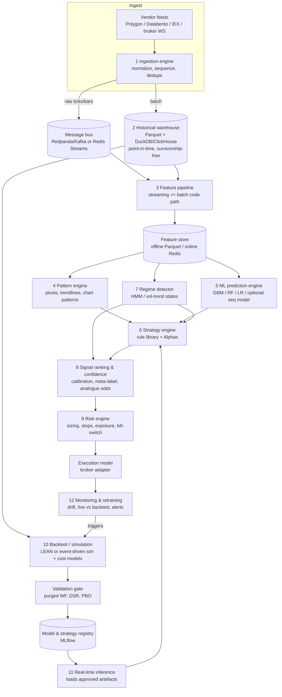

# Proposed Architecture: Independent AI Trading Intelligence Engine

**Design principle.** Take what the evidence shows works from each platform:
- **QuantConnect:** an event-driven engine and the modular Alpha → Portfolio → Risk → Execution chain.
- **TrendSpider:** barrier-outcome labels, classical classifiers with confidence thresholds, and geometric trendline/alert semantics.
- **Trade Ideas:** a curated rule library with rolling re-selection.
- **Tickeron:** analogue-frequency odds and regime-conditional model activation.

Then add the validation discipline that none of the closed platforms documents.

This is an original design. It copies no proprietary code. Where a component mirrors a vendor *concept*, the vendor is credited ([research_report.md](research_report.md)).

## System diagram

**Backbone choice.** Use **LEAN** (Apache-2.0) as components 10 and 11 plus the execution layer, rather than writing an engine. Components 3–9 run as LEAN framework models (Alpha, PCM, Risk, Execution), or as external services whose outputs feed LEAN as custom data (QC-7's "precomputed predictions" pattern). This is the fastest route to a correct backtest/live parity.

---

## Component specifications

### 1. Market data ingestion engine
| | |
|---|---|
| Purpose | Collect trades, quotes, bars, corporate actions, and fundamentals; normalize to one schema; publish to the bus and the warehouse. |
| Inputs | Vendor WebSocket/REST (e.g. Polygon, Databento, Alpaca, IBKR), corporate-action and reference files. |
| Outputs | `Trade`, `Quote`, `Bar` events (see [data_pipeline.md](data_pipeline.md)), each with an exchange timestamp and a receive timestamp. |
| Algorithms | Sequence-gap detection, dedupe by (symbol, ts, seq), late-arrival handling, bar aggregation (time, volume, dollar bars), trade-condition filtering. |
| Data structures | Arrow record batches; ring buffers per symbol. |
| Stack | Python asyncio or Rust/Go for high fan-in; Redpanda/Kafka (or Redis Streams at small scale). |
| Dependencies | Data vendor licence. |
| Training | None. |
| Metrics | Message lag p50/p99, gap rate, reconnect count, vendor-vs-consolidated price divergence. |
| Open source? | Yes (code). **Data is proprietary/paid.** |

### 2. Historical data warehouse
| | |
|---|---|
| Purpose | Point-in-time, survivorship-free history for research and backtests. |
| Inputs | Raw events, vendor history dumps, delisting files, splits and dividends, fundamentals with *publication* timestamps. |
| Outputs | Partitioned Parquet (`asset_class/freq/date/symbol`), adjusted and unadjusted views, security master with ID mapping across ticker changes. |
| Algorithms | Back-adjustment factors, as-of joins, symbol-to-permanent-ID mapping. |
| Stack | Parquet on S3/MinIO; DuckDB (single node) or ClickHouse/TimescaleDB (multi-user); LEAN data format if LEAN is the backbone. |
| Metrics | Completeness % per symbol-day, corporate-action reconciliation errors, point-in-time audit failures. |
| Open source? | Tooling yes. **Survivorship-free equities + fundamentals = paid data** (CRSP, Norgate, QuantConnect library, Databento). |

### 3. Feature engineering pipeline
| | |
|---|---|
| Purpose | Compute features identically offline (training) and online (inference). |
| Inputs | Bars/ticks from 1–2, regime labels from 7, pattern outputs from 4. |
| Outputs | Feature vectors keyed by (entity_id, as_of_ts) with a feature-set version. |
| Algorithms | Returns over many horizons, vol (Parkinson, Garman-Klass, EWMA), RSI/MACD/ATR/ADX, relative volume vs time-of-day profile, gap %, distance to VWAP, rank-normalized cross-sectional features, fractional differencing (ACAD-1), multi-timeframe aggregates (TrendSpider MTFA concept). |
| Data structures | Polars/pandas frames offline; incremental indicator state objects online. |
| Stack | Polars + TA-Lib; Feast (optional) for offline/online sync. |
| Metrics | Online/offline parity error (must be ≈0), feature null rate, PSI drift per feature. |
| Open source? | Yes. |

### 4. Technical pattern recognition engine
| | |
|---|---|
| Purpose | Deterministic detection of pivots, trendlines, S/R zones, and classic chart patterns; touch/bounce/break events. |
| Inputs | OHLCV per timeframe. |
| Outputs | `Line{anchor_a, anchor_b, slope, touches, score}`, `Zone{lo, hi, strength}`, `Pattern{type, state: emerging/confirmed, breakout_px, target_px, ts}`, `LineEvent{touch/bounce/break}`. |
| Algorithms | ATR-scaled zig-zag / fractal pivots; candidate lines from pivot pairs, scored by touches within an ATR tolerance, recency, and no-violation (concept consistent with TS-5 "filter all possible lines by relevance/proximity"); kernel-regression extrema for patterns (ACAD-4); measured-move targets. See [algorithm_reconstruction.md](algorithm_reconstruction.md) §2–3. |
| Data structures | Pivot arrays; line set per symbol/timeframe with incremental update on new bar. |
| Stack | NumPy/Numba. |
| Training | None. Thresholds are tuned in validation. |
| Metrics | Detection precision vs a hand-labelled sample; downstream: forward-return distribution conditional on events, vs a matched random baseline. |
| Open source? | Yes. |

### 5. ML prediction engine
| | |
|---|---|
| Purpose | Estimate P(outcome) for candidate trades. |
| Inputs | Features (3), pattern and regime context (4, 7), candidate events from 6 (event-based sampling). |
| Outputs | `p_win`, optional `E[return]`, model version. |
| Algorithms | **Primary:** LightGBM/XGBoost classifiers on triple-barrier labels. **Baselines:** logistic regression, random forest, KNN (TrendSpider's set; good sanity checks). **Optional:** a small TCN/LSTM/Transformer over raw bar sequences, only once a GBM baseline is beaten out-of-sample. **Meta-labelling** (ACAD-1): the primary rule gives the side; the ML model decides whether to take it. |
| Data structures | Training matrices with sample weights (uniqueness-weighted for overlapping labels). |
| Stack | scikit-learn, LightGBM, PyTorch (optional), MLflow. |
| Training | See [training_pipeline.md](training_pipeline.md): purged and embargoed walk-forward; Optuna HPO inside the inner folds only. |
| Metrics | Log-loss, Brier, AUC, calibration (ECE), precision at the operating threshold, and **economic metrics after costs**. |
| Open source? | Yes. |

### 6. Quantitative strategy engine
| | |
|---|---|
| Purpose | Library of explicit, parameterized strategies (Holly-style rule templates and pattern-breakout rules) that generate candidate trades with side, entry, stop, target, and time stop. |
| Inputs | Features, pattern events, regime state, ML scores. |
| Outputs | `Candidate{strategy_id, symbol, side, entry, stop, target, max_hold, context}` → LEAN `Insight`. |
| Algorithms | Rule DSL (boolean trees with "N bars ago" and multi-timeframe operands; cf. TS-5 multi-factor alerts); ATR-based stops and targets. |
| Selection | Rolling re-selection like Holly, **but** scored on purged out-of-sample windows with a deflated-Sharpe / SPA gate, and with a capped number of active strategies. |
| Stack | Python; LEAN `AlphaModel`. |
| Metrics | Per-strategy OOS expectancy after costs, hit rate, PF, turnover, capacity. |
| Open source? | Yes (the rule ideas are public TA; Holly's exact rules are not). |

### 7. Market regime detection
| | |
|---|---|
| Purpose | Label the current environment so strategies and models can be gated or weighted (Tickeron "FLM" concept; TI Risk-On/Off). |
| Inputs | Index returns, realized and implied vol (VIX), breadth, trend strength, rates/credit spreads. |
| Outputs | `regime_id`, regime probabilities, and a per-strategy activation weight. |
| Algorithms | Gaussian HMM / Markov-switching (ACAD-5) on vol and returns; a simple rule baseline (above/below the 200-day MA × vol tercile); optional clustering. |
| Training | Expanding window, refit monthly. Use **filtered** (not smoothed) probabilities only, to avoid look-ahead. |
| Metrics | Regime persistence, separation of strategy returns across regimes (OOS), stability of state mapping across refits. |
| Open source? | Yes (hmmlearn, statsmodels). |

### 8. Signal ranking and confidence engine
| | |
|---|---|
| Purpose | Turn heterogeneous candidates into one ranked list with an honest probability and expected value. |
| Inputs | Candidates (6), `p_win` (5), analogue statistics (Tickeron-style k/n), regime weight (7). |
| Outputs | `score = calibrated_p × avg_win − (1−calibrated_p) × avg_loss − cost`, with a Wilson interval and rank. |
| Algorithms | Isotonic/Platt calibration on OOS predictions; Bayesian shrinkage of per-strategy hit rates toward the global mean (Beta-Binomial); analogue odds with Wilson CIs; de-duplication of correlated signals. |
| Metrics | Calibration curve, top-k precision, rank IC vs realized R-multiple. |
| Open source? | Yes. |

### 9. Risk management engine
| | |
|---|---|
| Purpose | Size positions and enforce limits before any order. |
| Inputs | Ranked signals, portfolio state, covariance estimates, account limits. |
| Outputs | Adjusted `PortfolioTarget`s, rejections with reasons, kill-switch state. |
| Algorithms | Fixed-fractional risk per trade (e.g. 0.5% equity / stop distance); vol targeting; fractional Kelly capped by the calibrated-p lower bound; max positions; sector/correlation caps (cf. LEAN sector model); daily loss limit; per-security and portfolio drawdown stops (LEAN built-ins); gap-risk haircut; liquidity cap (≤1% ADV). |
| Stack | LEAN `RiskManagementModel` + `PortfolioConstructionModel`. |
| Metrics | Realized vs target risk, limit breaches (must be 0), max DD, tail loss (CVaR). |
| Open source? | Yes. |

### 10. Backtesting and simulation engine
| | |
|---|---|
| Purpose | Event-driven, cost-realistic evaluation; the same code path as live. |
| Inputs | Warehouse data, strategy/model artefacts, reality models. |
| Outputs | Trades, equity curve, statistics, and a reproducibility hash (data version + code commit + config). |
| Algorithms | LEAN time-slice simulation; fill models (next-bar open or quote-side, partial fills by volume); spread + impact slippage (e.g. square-root impact); fees; borrow availability; halts. Also vectorbt for fast parameter sweeps, but **any decision gets confirmed in the event-driven engine**. |
| Metrics | Sharpe, Sortino, Calmar, max DD and duration, PF, win rate, expectancy (R), turnover, capacity, **Deflated Sharpe, PBO**, regime-split results. |
| Open source? | Yes (LEAN). |

### 11. Real-time inference engine
| | |
|---|---|
| Purpose | Run approved models and strategies on live data within a latency budget. |
| Inputs | Bus events, online feature store, registry artefacts. |
| Outputs | Live Insights/orders, signal logs with full feature snapshots (for replay). |
| Algorithms | Incremental indicator updates; batched model scoring per bar close; ONNX/treelite for GBM speed. |
| Stack | LEAN live mode, or a Python service (FastAPI + Redis) emitting signals into LEAN/broker. |
| Metrics | Bar-close → signal latency p99, missed bars, live/backtest signal parity on replayed days. |
| Target | Bar-based swing/intraday (≥1-min bars). Sub-millisecond HFT is out of scope: it needs co-location and proprietary feeds. |

### 12. Performance monitoring and retraining pipeline
| | |
|---|---|
| Purpose | Detect decay and trigger revalidation; never auto-promote without the validation gate. |
| Inputs | Live fills, signal logs, feature drift statistics, backtest expectations. |
| Outputs | Dashboards, alerts, retrain jobs, strategy suspension. |
| Algorithms | PSI/KS feature drift; rolling calibration (Brier); CUSUM or Page-Hinkley on per-trade R; live-vs-backtest slippage reconciliation; probabilistic Sharpe of live results vs backtest. |
| Stack | Prometheus + Grafana, MLflow registry, Prefect/Airflow scheduler. |
| Metrics | Time-to-detect decay, false-alarm rate, slippage bps live vs model. |
| Open source? | Yes. |

---

## Open source vs proprietary requirements

| Need | Open-source path | Needs proprietary data or research |
|---|---|---|
| Engine, backtest, live trading | LEAN, vectorbt, broker APIs | — |
| ML, calibration, HPO, tracking | scikit-learn, LightGBM, PyTorch, Optuna, MLflow | — |
| Patterns, trendlines, regimes | NumPy/Numba, hmmlearn, statsmodels | — |
| Daily US-equity OHLCV | Free sources (survivorship-biased) | Survivorship-free history with delistings (paid) |
| Intraday/tick history, full quotes | — | Paid (Polygon, Databento, AlgoSeek, QuantConnect library) |
| Point-in-time fundamentals | — | Paid (Sharadar, Morningstar, Compustat) |
| Holly's exact 60+ rules and thresholds; Tickeron's FLM internals | — | Not public; design your own |
| Edge itself | — | Original research; nothing here guarantees one |
