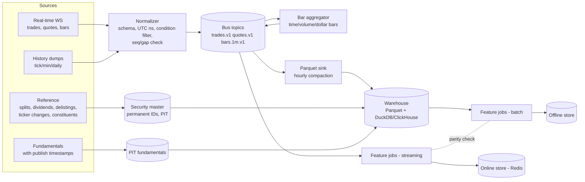

# Market Data and Feature Engineering Architecture

Companion to [ai_architecture.md](ai_architecture.md) components 1–3.

## 1. Data flow



**Rule.** Batch and streaming features call **the same functions** (incremental indicator objects replayed over history). That is how you get online/offline parity. LEAN gets the same effect because backtest and live share the indicator code [QC-2].

## 2. Event schemas

```text
Trade   { sid:int64, ts_event:ns, ts_recv:ns, px:f64, size:u32, exch:u8, cond:u32 bitmask, seq:u64 }
Quote   { sid, ts_event, ts_recv, bid:f64, ask:f64, bid_sz:u32, ask_sz:u32, exch, seq }
Bar     { sid, ts_open, ts_close, o,h,l,c:f64, v:f64, vwap:f64, n_trades:u32, kind:{time|volume|dollar}, interval }
CorpAct { sid, ex_date, type:{split|div|spin|delist|rename}, ratio|amount, new_sid? }
Fund    { sid, field, value, period_end, published_ts }   # as-of key = published_ts
Order book (optional, L2/L3): { sid, ts, side, px, size, action:{add|mod|del}, order_id? }
```
- `sid` = permanent security ID from the security master. Never key data by ticker.
- Keep **both** `ts_event` and `ts_recv`. Backtests that use `ts_event` while live trading sees `ts_recv` latency carry an optimistic bias.

## 3. Cleaning and normalization
| Problem | Treatment |
|---|---|
| Bad prints / out-of-sequence trades | Drop by condition codes (e.g. odd-lot, late, out-of-sequence where appropriate); median-absolute-deviation filter vs rolling mid |
| Crossed/locked quotes | Flag; exclude from spread statistics |
| Gaps in sequence | Request replay from the vendor; mark the bar `incomplete` |
| Splits/dividends | Store raw; produce adjustment factors; research uses returns or as-of-adjusted prices |
| Ticker changes / delistings | Security master maps the old ticker to the same `sid`; delisting return included |
| Session handling | Explicit pre-market/RTH/after-hours flags; time-of-day features use exchange-local time |
| Halts | Halt table; the simulator blocks fills during a halt |

## 4. Feature catalogue (starter set)

All features are causal and computed at bar close `t`.

| Group | Features | Concept source |
|---|---|---|
| Returns | log return over 1, 5, 20, 60 bars; overnight gap %; intraday return since open | standard |
| Volatility | ATR(14)%, Parkinson, Garman-Klass, EWMA vol, vol-of-vol, realized/implied ratio (if options data) | standard |
| Momentum/oscillators | RSI(14/20/28/56) (TS-3 example), MACD hist, ROC, stochastic %K, Aroon up/down (TK-1 examples), ADX | TS, TK |
| Volume/liquidity | relative volume vs same-time-of-day 20-day profile, dollar volume, float turnover, spread bps, Amihud illiquidity | TI filters (rel-vol, float) |
| Price location | distance to VWAP (in ATR), to N-day high/low, to nearest S/R zone, to trendline (in ATR), Fibonacci retracement level of the current pullback | TI "Buyers Stepping", TS trendlines |
| Pattern/event | pattern type one-hot, state (emerging/confirmed), bars since breakout, touches on the active line, historical analogue hit rate (shrunk) | TS, TK |
| Multi-timeframe | the above on 5m/15m/60m/1D aggregated to the decision timeframe; trend agreement count | TS MTFA, TK 5/15/60 |
| Cross-sectional | rank of return/rel-vol within sector and universe; sector ETF return | standard |
| Market context | SPY/QQQ return and trend, VIX level/change, breadth (% above 50-DMA), regime ID and probabilities | TI risk-on/off, TK FLM |
| Time | minute-of-session, day-of-week, days to earnings (PIT calendar) | TI "Power Hour" |
| Fundamentals (daily+) | PIT valuation, growth, quality, short interest, days-to-cover | TS/TK fundamentals |
| Stationarity | fractionally differenced log price (d≈0.3–0.5, ACAD-1) | academic |

**Feature-set versioning.** Each model records the `feature_set_id`, the code commit, and the data snapshot.

## 5. Storage and infrastructure
| Layer | Small (solo/research) | Production |
|---|---|---|
| Bus | Redis Streams | Redpanda/Kafka, topic per event type, partitioned by `sid` |
| Hot store | Redis (latest features, indicator state) | Redis Cluster |
| Warehouse | Parquet + DuckDB on local SSD | Parquet on S3 + ClickHouse (or TimescaleDB) |
| Feature store | Parquet offline + Redis online (hand-rolled) | Feast |
| Orchestration | cron / Prefect | Airflow/Prefect + Kubernetes |
| Compute | 1 box, 16–32 cores, 64 GB | Spot cluster for backtests/HPO (Ray/Dask) |
| Model serving | In-process (LEAN Python or FastAPI) | ONNX/treelite in a scoring service |
| Monitoring | Grafana + Prometheus, structured JSON logs | + Loki/ELK, alerting (PagerDuty) |

**Rough volumes.** US equities 1-min bars for ~8k symbols ≈ 3M rows/day ≈ 50–100 MB/day as Parquet. Full TAQ is 100× larger, so only buy it when the strategy needs quotes.

## 6. Latency budget (bar-based strategies)
| Step | Budget |
|---|---|
| Vendor → normalizer | 5–50 ms (internet feed) |
| Bar close → features updated | < 50 ms for 1k symbols |
| Features → model scores (GBM, batched) | < 20 ms |
| Ranking + risk | < 10 ms |
| Order to broker | 20–200 ms (retail API) |

At this budget, 1-min-and-up intraday and swing strategies are viable. Holly-style real-time alerting across the whole market needs the streaming path to keep up with the full trade feed. Plan for 5k–50k msgs/sec at the open.

## 7. Data quality checks (automated, daily)
- Row counts per symbol-day vs the exchange calendar.
- OHLC sanity: `l ≤ min(o,c) ≤ max(o,c) ≤ h`, `v ≥ 0`.
- Day-over-day adjusted-price jumps > 30% without a corporate action → quarantine.
- Vendor A vs vendor B close divergence > 10 bps on a sample → alert.
- Point-in-time audit: re-build features for a random past date from the warehouse and compare them to what was logged live.
