# Implementation Roadmap

**Assumptions:** 1–2 engineers, Python-first, LEAN as the backbone, US equities/ETFs, bar-based (≥1-min) strategies. Week counts are effort estimates, not promises.

**Phase order rationale:** data correctness → evaluation honesty → simple signals → ML → live. Building the "AI" before the validation harness is how the closed platforms' blind spots get reproduced.

```mermaid
gantt
  dateFormat  X
  axisFormat  W%s
  section Foundation
  P0 Setup & data licence          :0, 2
  P1 Warehouse + security master   :2, 4
  section Evaluation
  P2 LEAN backtests + cost models  :6, 3
  P3 Validation harness (purged WF, DSR, PBO) :9, 3
  section Signals
  P4 Rule library + pattern engine :12, 4
  P5 Analogue odds + ranking       :16, 2
  section ML
  P6 Barrier labels + model ladder :18, 4
  P7 Regime layer + selector       :22, 3
  section Live
  P8 Streaming + shadow/paper      :25, 4
  P9 Monitoring + retrain loop     :29, 3
```

| Phase | Deliverable | Exit criterion (must pass before moving on) |
|---|---|---|
| **P0 Setup** (wk 0–2) | Repo, CI, `pip install lean`, Docker, MLflow, data vendor chosen (e.g. Polygon or Databento for intraday; Norgate or QuantConnect library for survivorship-free daily). | LEAN sample backtest runs locally; vendor API pulls one day of data. |
| **P1 Data** (wk 2–6) | Ingestion → Parquet warehouse; security master with permanent IDs, delistings, corporate actions; daily quality checks ([data_pipeline.md](data_pipeline.md) §7). | 5+ years daily and 2+ years 1-min loaded; PIT audit passes; delisted names present. |
| **P2 Backtest engine** (wk 6–9) | LEAN custom data reader for the warehouse; fee, slippage (spread + sqrt impact), and fill models; halt handling. | Buy-and-hold SPY matches an independent calculation within 1 bp/yr; a known toy strategy reproduces in LEAN and vectorbt. |
| **P3 Validation harness** (wk 9–12) | Purged/embargoed walk-forward, CPCV, Deflated Sharpe, PBO, SPA test, baseline generators (random entry, same exits), report template. | Unit test proves no train/test label overlap. A deliberately overfit strategy (best of 1,000 random rules) is **rejected** by the gate. |
| **P4 Rules + patterns** (wk 12–16) | 15–25 Holly-like intraday/swing rule templates (breakout, pullback, gap fade, power hour, rel-vol surge); pivot/trendline/S-R/pattern engine with touch/bounce/break events ([algorithm_reconstruction.md](algorithm_reconstruction.md) §2–3). | Each rule's OOS after-cost stats are reported; at most a few survive the gate. **That is the expected, correct result.** |
| **P5 Odds + ranking** (wk 16–18) | Analogue k/n odds with Wilson CI and shrinkage; EV-based ranking; position sizing. | Ranking IC > 0 OOS; calibration plot within ±5 pp. |
| **P6 ML** (wk 18–22) | Event-sampled triple-barrier dataset; model ladder LR → RF → LightGBM (→ sequence model only if justified); meta-labelling on surviving rules; isotonic calibration. | ML filter beats the raw rule on OOS expectancy *and* DSR with the true trial count. Otherwise ship rules without ML. |
| **P7 Regime + selector** (wk 22–25) | HMM/rule regime model (filtered probabilities); regime-gated activation; rolling selector evaluated walk-forward ([training_pipeline.md](training_pipeline.md) §10). | The selector's stitched OOS P&L beats a static equal-weight portfolio of the same rules. |
| **P8 Live path** (wk 25–29) | Streaming features (same code as batch), LEAN live with a broker paper account (Alpaca/IBKR), signal logs with feature snapshots. | Replayed-day parity: live signals = backtest signals ≥ 99%. 4 weeks of shadow, then 4 weeks of paper. |
| **P9 Monitoring** (wk 29–32) | Grafana dashboards, drift (PSI), Brier/CUSUM alarms, slippage reconciliation, kill-switch, monthly retrain job with the gate. | A synthetic decay injection triggers an alarm within the target window. The kill-switch is tested. |

## Team and cost guide (indicative)
| Item | Low | Higher |
|---|---|---|
| Data (daily survivorship-free + 1-min US equities) | ~$50–200/mo | $500–2k+/mo with quotes/TAQ |
| Compute | 1 workstation | Cloud spot cluster for HPO/CPCV |
| Broker | Paper accounts free | Live: commissions + market data fees |

## Risks and mitigations
| Risk | Mitigation |
|---|---|
| No real edge exists after costs | Gate everything on DSR/PBO; treat "no strategy survives" as a valid outcome |
| Data errors create fake alpha | P1 quality checks; cross-vendor validation; PIT audits |
| Leakage via features or labels | P3 tests; code review checklist ([training_pipeline.md](training_pipeline.md) §8) |
| Backtest/live divergence | Same code path (LEAN), slippage reconciliation, shadow period |
| Overfitting through researcher iteration | Log every trial in MLflow; feed the count into DSR; single-use holdout |
| Regulatory | Personal trading only unless licensed; signals to third parties may count as investment advice in many jurisdictions. Get legal review before offering signals. |

## Definition of done (research-grade)
1. Every reported metric is reproducible from `(data snapshot, commit, config)`.
2. Every promoted strategy has OOS, after-cost, regime-split results and a DSR > 0.95 using the logged trial count.
3. Live P&L is tracked against the backtest expectation with a pre-registered decay alarm.
